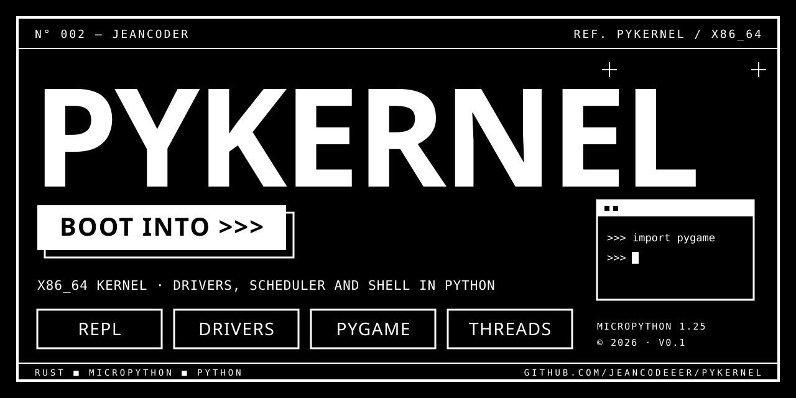
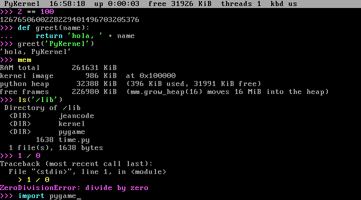
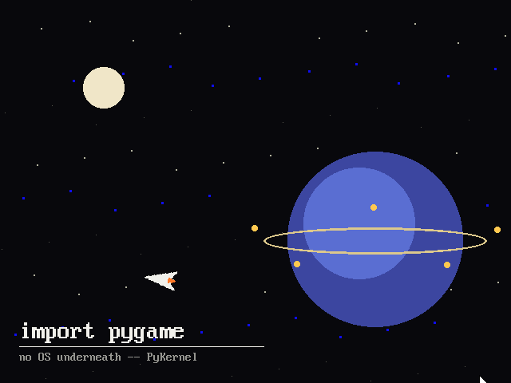
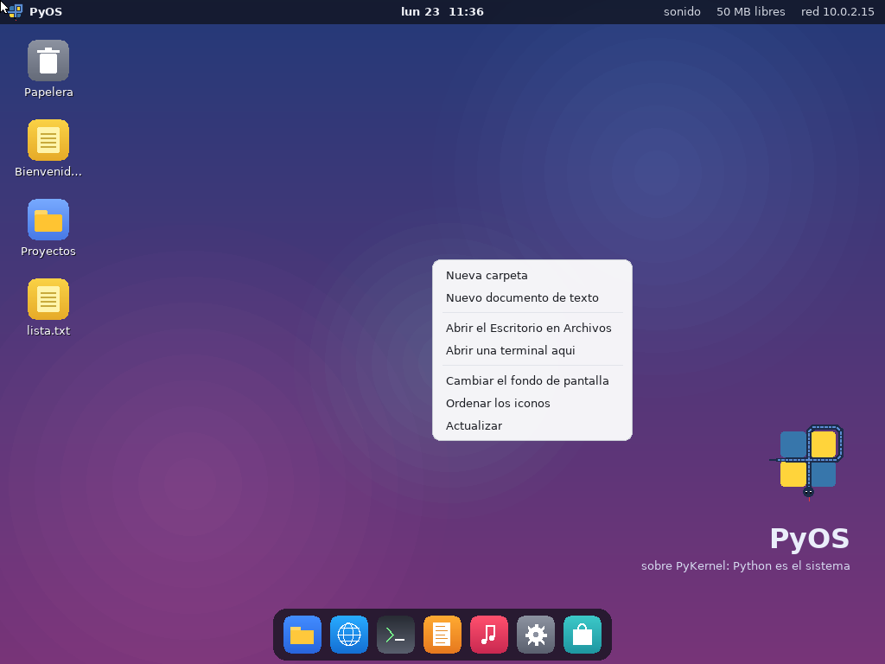
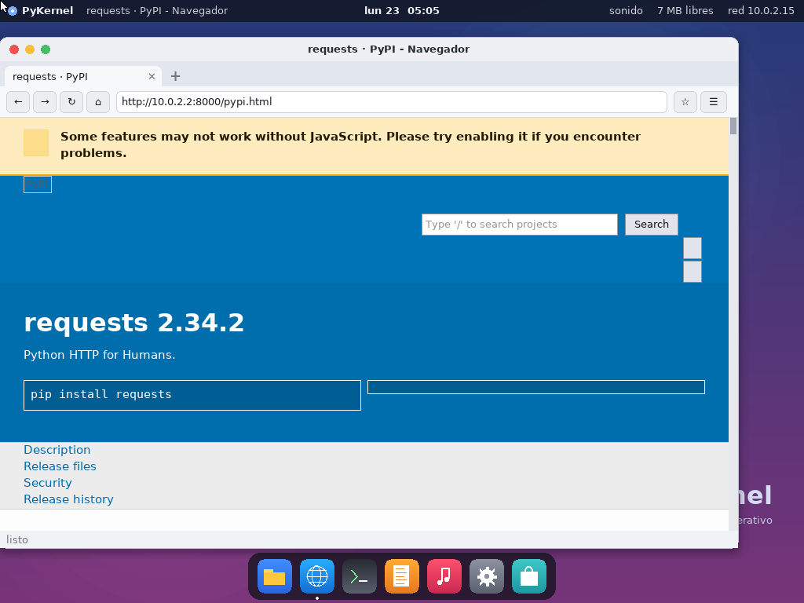
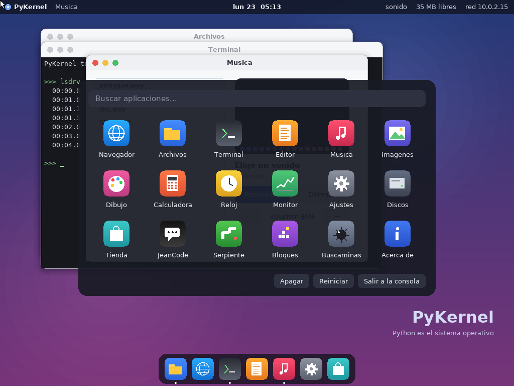

<div align="center">



<br>

# PyKernel — enciende un PC y aterriza en `>>>`

**Los drivers, el gestor de memoria, el planificador y la consola son Python que puedes leer y cambiar.**<br>
Un kernel x86_64 sin sistema operativo debajo: unas 1.200 líneas de Rust preparan la CPU, arranca una máquina virtual de MicroPython y todo lo demás es Python.

[](#02--inicio-rápido)
[](https://github.com/jeancodeeer/PyKernel/releases/latest)
[](https://github.com/micropython/micropython)
[](LICENSE)

[`ENGLISH`](PYKERNEL.md) · **`ESPAÑOL`**

</div>

```
N° 002 — PYKERNEL                                                     REF. 0.1
x86_64 · ~1.200 líneas de Rust y después Python hasta arriba. Arranca en QEMU.
MicroPython, no CPython · subconjunto compatible con pygame, no pygame · probado en QEMU, no en hardware
```

<p align="center">
  
  <br><sub>La consola recién arrancada, en QEMU: Python normal, un bloque escrito en dos líneas, comandos al estilo DOS (<code>mem</code>, <code>ls</code>) y un error que enseña la línea que falló. La fila de arriba es la barra de estado del kernel.</sub>
</p>

<br>

> **PyKernel y PyOS son dos cosas.** Este repositorio tiene las dos: **PyKernel** (`pyfs/`) es el núcleo (arranque, drivers, memoria, red, procesos, la consola `>>>`) y funciona solo. **PyOS** (`pyos/`) es el sistema operativo que la gente usa encima: el escritorio, las apps (todas archivos `.py` con pygame), el navegador, las fuentes y los sonidos. Ver [pyos/README.md](pyos/README.md).
>
> 

## 01 — QUÉ ES

Enciendes la máquina. Ni Windows, ni Linux, ni un script de arranque: GRUB carga el kernel, unos cientos de líneas de Rust pasan la CPU a modo 64 bits y arrancan un intérprete de Python, y estás en un prompt `>>>` **que es el sistema operativo**.

Todo lo que hay por encima es un archivo `.py`:

- los **drivers**: pantalla, teclado y ratón, temporizador, controlador de interrupciones, reloj, PCI, disco IDE, puertos serie, gráficos;
- el **gestor de memoria**: marcos físicos y tablas de páginas x86_64, leídas y editadas desde Python;
- **hilos con desalojo**, tareas en segundo plano y un **sistema de archivos FAT** en el disco;
- la **consola**, un **editor de texto** a pantalla completa, **comandos** al estilo DOS y una **API gráfica compatible con pygame**.

Los cambias sin compilador: editas y vuelves a arrancar (o `Ctrl-D`, que reinicia el mundo Python ahí mismo).

<p align="center">
  
  <br><sub><code>run('/lib/pygame/examples/showcase.py')</code>: código al estilo pygame que dibuja directamente en la tarjeta de vídeo, a 30 fotogramas por segundo, sin sistema operativo debajo.</sub>
</p>

<p align="center">
  
  
  
  
  <br><sub><code>desktop</code>: ventanas, barra de tareas y aplicaciones en pygame, y un navegador escrito en Python mostrando el HTML y el CSS reales de PyPI.</sub>
</p>

<br>

## 02 — INICIO RÁPIDO

Solo necesitas [QEMU](https://www.qemu.org/download/) (`winget install SoftwareFreedomConservancy.QEMU` · `brew install qemu` · `sudo apt install qemu-system-x86`). Sin compilar nada.

| QUIERES | HAZ ESTO |
|---|---|
| **Probarlo** (segundos hasta `>>>`) | Descarga [`pykernel.iso`](https://github.com/jeancodeeer/PyKernel/releases/latest/download/pykernel.iso) y luego:<br>`qemu-system-x86_64 -cdrom pykernel.iso -m 512M` |
| **Archivos que sobrevivan al apagado** | Crea una vez un disco vacío —`qemu-img create -f raw disk.img 32M`— y arranca con él:<br>`qemu-system-x86_64 -cdrom pykernel.iso -drive file=disk.img,format=raw -boot d -m 256M`<br>Se formatea (FAT) en el primer arranque y se monta en `/disk`. |
| **Modificarlo** | Clona este repositorio y mira [08 — COMPÍLALO TÚ](#08--compílalo-tú). |

Después, en el prompt:

```python
>>> help                                   # todos los comandos, uno por línea
>>> ls('/lib/kernel')                      # el código fuente del propio kernel
>>> edit('/lib/kernel/keyboard.py')        # leer (y cambiar) un driver, a pantalla completa
>>> run('/lib/pygame/examples/bounce.py')  # un juego pequeño: flechas o ratón; Esc sale
>>> kbd('es')                              # teclado español (también 'latam' y 'us')
```

Sin `-drive`, todo vive en la RAM y desaparece al apagar.

<br>

## 03 — PARA QUÉ SIRVE

No es un sistema para el día a día. Es un ordenador que se puede **leer**: lo que cuentan los libros de sistemas operativos, escrito en el lenguaje que casi todo el mundo aprende primero.

| PUEDES | CÓMO |
|---|---|
| **Ver cómo un driver habla de verdad con el hardware** | `edit('/lib/kernel/ata.py')`: el driver de disco IDE entero es una clase de Python corta: elegir un sector, esperar al disco y mover 512 bytes por un puerto de E/S. |
| **Tocar las tablas de páginas con la máquina en marcha** | `mm.translate(0xB8000)` recorre los cuatro niveles de tablas de páginas x86_64; `mm.map_page(...)` añade una asignación que puedes usar en la línea siguiente. |
| **Cambiar el teclado en vivo** | `keyboard.bind('f2', lambda: print('hola'))`, cambia la distribución con `kbd('es')`, o edita `keyboard.py` y pulsa `Ctrl-D`. |
| **Ver las interrupciones y los hilos** | `irqs` cuenta las interrupciones por línea; `thread.start(fn)` lanza hilos reales con desalojo; `ps`, `kill(id)`. |
| **Enseñar sistemas operativos sin C** | Interrupciones, temporizadores, planificación, paginación y sistemas de archivos, cada uno en un archivo que se puede abrir en clase. |
| **Hacer jueguitos sobre el hierro** | `import pygame`: un subconjunto compatible con pygame 2, con teclado, ratón, fuentes, imágenes y sprites. |

<br>

## 04 — QUÉ TRAE

| | |
|---|---|
| **Consola** | Un REPL de Python que se comporta como el de CPython 3.13: su banner, `sys.ps1` / `sys.ps2`, `_`, bloques editados enteros (la flecha arriba recupera un bloque completo), `exit` / `quit`, F1 ayuda, F2 historial, F3 modo pegado, prompt y errores en color. Colores de sintaxis al escribir, Tab completa, Ctrl-R busca en el historial, que se guarda en el disco. Los errores muestran la línea que falló. |
| **Comandos** | `ls cat more find sort tree copy move rm mkdir cd pwd write edit run mem ps kill irqs lspci date uptime dmesg history kbd keys alias cls ver reboot poweroff`: escribe el nombre solo, al estilo DOS, `ls['/lib']` con argumentos, `ls > 'salida.txt'`, `ls | find['boot']`. |
| **Editor** | `edit('archivo.py')`: pantalla completa, colores de Python, sangría automática, buscar, ir a línea, cortar y pegar líneas. |
| **Pantalla y teclado** | Consola de texto VGA con colores ANSI 16/256, 500 líneas para volver atrás, barra de estado y UTF-8 (ñ, á, recuadros). Distribuciones EE. UU., España y Latinoamérica generadas desde los archivos de teclado de X11, con AltGr y teclas muertas. Ratón PS/2. |
| **API compatible con pygame** | `Surface`, `Rect`, `Color`, `display`, `draw`, `event`, `key`, `mouse`, `time`, `font`, `image` (BMP, PNG), `transform`, `sprite`, `mixer`. Los píxeles los dibuja un pequeño módulo en C. Ctrl+Q envía `QUIT` (no hay ventana que cerrar). |
| **Hilos y tareas** | Hilos del kernel con desalojo detrás del módulo estándar `_thread`; tareas con generadores que avanza el temporizador; `kill` y Ctrl-C por hilo, sin que una escritura al disco quede a medias. |
| **Almacenamiento** | Driver de disco IDE/ATA, sistema de archivos FAT en `/disk` (legible en cualquier otro ordenador), `/disk/autoexec.py` al arrancar, `/disk/lib` en la ruta de importación. |
| **Red** | Drivers virtio-net y e1000 en Python, y una pila TCP/IP completa en `/lib/kernel/net.py`: Ethernet, ARP, IPv4, ICMP, UDP, TCP (retransmisión, ventana, servidor con `listen`/`accept`), DHCP y DNS. Módulo `socket` estándar encima. Comandos `ifconfig ping netstat nslookup wget curl`. |
| **HTTPS** | TLS 1.3 escrito en Python (`/lib/ssl.py`): X25519, ChaCha20-Poly1305, certificados RSA y ECDSA verificados contra las raíces de Mozilla. `http.client`, `urllib.request` y un `requests` pequeño. |
| **Escritorio** | `desktop`: pantalla de arranque, inicio de sesión (si las cuentas tienen contraseña), barra superior, dock y lanzador con búsqueda, ventanas redondeadas con sombra y fuentes DejaVu suavizadas, todo dibujado con pygame. Apps: terminal Python, archivos, editor, navegador, monitor del sistema, configuración, discos e instalador, tienda de paquetes, calculadora, dibujo, imágenes (PNG, BMP, GIF, JPEG), reloj y calendario, tres juegos y un reproductor de música. |
| **Navegador web** | Escrito en Python (`/lib/browser`): HTML, CSS (selectores, cascada, `@media`), tablas, listas, imágenes, formularios, pestañas, marcadores, historial, cookies, buscar en la página, ver código. Sin JavaScript. `browse('https://…')`. |
| **Sistema** | Procesos con PID, padre, argumentos, entorno, señales y código de salida (`procs start pkill`); `/dev` y `/proc`; usuarios con contraseñas PBKDF2 (`useradd su passwd`); servicios de arranque con reinicio y `crontab`; gestor de paquetes `pkg` (índice de micropython-lib y GitHub). |
| **Drivers** | Todos en Python: discos IDE, SATA (AHCI), NVMe y memorias USB; red virtio-net, e1000 y RTL8139; teclados y ratones USB (xHCI); sonido AC'97 con `pygame.mixer` reproduciendo WAV; gráficos Bochs/QEMU. `lsdrv` muestra qué driver tiene cada dispositivo. |
| **Hardware** | ACPI (apagado y reinicio reales), APIC local, I/O APIC y HPET, discos SATA por AHCI además de IDE, particiones MBR. `cpus('start')` despierta los demás núcleos con INIT-SIPI (se cuentan y quedan en espera: Python corre en un núcleo). `serve('/carpeta', 80)` es un servidor HTTP y `ntpdate` pone la hora. |
| **JeanCode** | `jeancode` (o su icono en el lanzador) abre [JeanCode](https://github.com/jeancodeeer/JeanCode), mi cliente de chat con IA, a pantalla completa. Con tarjeta de red habla HTTPS directo, con la pila TCP/IP y el TLS del propio kernel; sin red usa el puente por el puerto serie; ver [05](#05--cómo-funciona). |

<br>

## 05 — CÓMO FUNCIONA

```
+--------------------------------------------------------------+
|  >>>  consola, comandos, editor, pygame, JeanCode            |  pyfs/lib/kernel/repl.py, shell.py
|  drivers: consola VGA, teclado + ratón PS/2, vídeo, serie,   |  pyfs/lib/kernel/*.py
|  PIC, PIT, RTC, PCI, ATA; marcos, tablas de páginas, hilos   |  (~4.200 líneas de Python)
|  sistema de archivos en RAM, secuencia de arranque           |  pyfs/init.py
+--------------------------------------------------------------+
|  Máquina virtual MicroPython (C)  + enlaces _kernel / _gfx   |  mpy/
+--------------------------------------------------------------+
|  Rust: modo largo, paginación, IDT + reparto de interrupcio- |  rust/  (~1.200 líneas)
|  nes, cambio de contexto, puertos / MSR / CR, heap, arranque |
+--------------------------------------------------------------+
```

**Rust** hace solo lo que Python no puede físicamente: entrar en modo 64 bits, instalar la tabla de interrupciones, cambiar la pila de cada hilo y exponer las instrucciones de la CPU (`in`/`out`, MSR, registros de control, `cpuid`, `rdtsc`). Cada interrupción se cuenta y se entrega al manejador de Python registrado para ella; un fallo de la CPU mientras corre Python se convierte en una excepción de Python en lugar de colgar la máquina.

**C** une MicroPython a esa capa (`_kernel`: puertos de E/S, interrupciones, hilos, consola) y dibuja los píxeles de pygame (`_gfx`). MicroPython v1.25.0 se usa tal cual, más un parche pequeño en `mpy/patches/`.

**Python** es el kernel: `boot.py` levanta la máquina en un orden que puedes cambiar, y cada driver es código normal que usa `inb`/`outb` y `uctypes.bytearray_at(dirección, tamaño)` para la memoria.

**JeanCode sin tarjeta de red:** cada petición sale por COM2 como una línea JSON; `tools/jeancode_bridge.py`, en el anfitrión, hace la llamada HTTPS y devuelve la respuesta en streaming. `python tools/run.py` lo conecta solo. Con la ISO, arranca QEMU con `-serial vc -serial tcp:127.0.0.1:4555,server=on,wait=off` y ejecuta `PYTHONPATH=pyfs/lib python tools/jeancode_bridge.py --connect 127.0.0.1:4555` desde un clon de este repositorio. El puente solo registra el método y el servidor.

<br>

## 06 — LÍMITES, SIN ADORNOS

| QUÉ | DICHO CLARO |
|---|---|
| **Motor** | MicroPython, no CPython. La consola se siente como la de CPython, pero no hay `pip`: los módulos pequeños de Python puro se pueden copiar y suelen funcionar; los paquetes con extensiones en C, no. |
| **pygame** | Un subconjunto compatible escrito para este kernel, no el pygame real (ese necesita SDL y CPython). Sin sonido: `mixer` acepta todas las llamadas y no suena nada. |
| **Dónde funciona** | Probado solo en QEMU. Puede que un PC real no lo arranque. Los gráficos necesitan el adaptador de vídeo tipo Bochs que tienen QEMU, Bochs y VirtualBox. |
| **Hardware** | Python corre en un solo núcleo. Hay drivers para lo que emulan QEMU y VirtualBox (y PCs antiguos); sin Wi-Fi, sin Intel HD Audio, sin hubs USB, y solo teclados y ratones USB en modo de arranque. |
| **Navegador** | Sin JavaScript: las páginas que lo necesitan para mostrarse se ven incompletas. Una sola fuente (8×16), CSS parcial (sin floats reales, `position` ni grid), sin JPEG progresivo, WebP ni SVG. Las páginas grandes tardan segundos en maquetarse. |
| **Seguridad** | Todo corre con privilegios máximos (anillo 0). Los procesos tienen su propio espacio de nombres y memoria propia por `mm.AddressSpace`, pero no hay aislamiento por hardware: un proceso puede leer o romper a otro. El TLS no es de tiempo constante. Para eso es un laboratorio, y por eso no hay que confiarle datos. |
| **Persistencia** | Solo `/disk` sobrevive al apagado. «Instalar» (app Discos) copia `/lib`, `/bin` y `/etc` a `/disk/system`, que va primero al importar; el arranque sigue necesitando GRUB del CD o la ISO. |
| **JeanCode** | Las claves de API que escribas en JeanCode se guardan en **texto plano** en `/disk/jeancode/`. |

> ⚠️ **En un PC real:** el driver de disco escribe en el primer disco IDE/ATA que encuentra. Arráncalo solo en una máquina sin discos que te importen, o con los discos desconectados.

<br>

## 07 — SE BUSCA AYUDA

- **Pruébalo en hardware real** y cuéntanos qué pasó: hay una plantilla de [informe de hardware](../../issues/new?template=hardware-report.md); una foto de la pantalla es perfecta.
- **Drivers**: Intel HD Audio, hubs USB, Wi-Fi, gráficos VBE/GOP preparados por el gestor de arranque, pruebas en hardware real.
- **Varios núcleos** (los demás núcleos con INIT-SIPI), **modo usuario** (anillo 3) y aislamiento de procesos por hardware.
- **Navegador**: JavaScript, fuentes escalables, floats y `position`.

<br>

## 08 — COMPÍLALO TÚ

Hoy, Windows + WSL (Ubuntu); en Linux es igual, sin el paso por `wsl`.

| HACE FALTA | |
|---|---|
| Rust | `rustup target add x86_64-unknown-none` y `rustup component add llvm-tools` |
| En WSL / Linux | `sudo apt install build-essential python3 qemu-system-x86` (+ `qemu-system-gui` para una ventana, `grub-pc-bin xorriso mtools` para la ISO) |
| MicroPython | se descarga solo (submódulo de git, v1.25.0) |

```
git clone https://github.com/jeancodeeer/PyKernel && cd PyKernel
python tools/build.py          # VM de MicroPython (en WSL) -> kernel en Rust -> build/kernel.bin + build/pyfs.img
python tools/run.py            # arrancar; la consola en esta terminal (Ctrl-A X sale)
python tools/run.py --screen   # la pantalla y el teclado del PC en una ventana
python tools/test.py           # 89 comprobaciones en QEMU: teclas, pantalla, disco, apagado, pygame
python tools/test_net.py       # red, HTTP y TLS 1.3 contra servidores en este equipo
python tools/test_desktop.py   # cada app del escritorio, y el navegador con un sitio de prueba
python tools/iso.py            # build/pykernel.iso, arrancable desde CD o USB
```

Editar Python no requiere compilar: cambia `pyfs/` y vuelve a ejecutar. Empieza a leer por [CONTRIBUTING.md](CONTRIBUTING.md), que tiene un recorrido corto por el código.

<br>

## 09 — LICENCIA

[MIT](LICENSE). MicroPython también es MIT ([aviso](pyfs/licenses/MicroPython.txt), también dentro de la imagen en `/licenses`); ver [THIRD_PARTY.md](THIRD_PARTY.md).

<div align="center">

<br>

Si PyKernel te enseñó algo sobre cómo funcionan los ordenadores, una ⭐ ayuda a que otros lo encuentren.

```
JEANCODER © 2026 — RUST ■ MICROPYTHON ■ PYTHON
```

</div>
