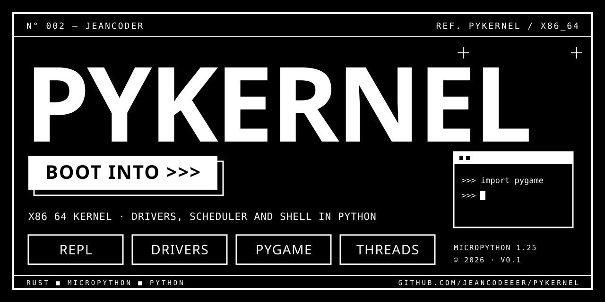
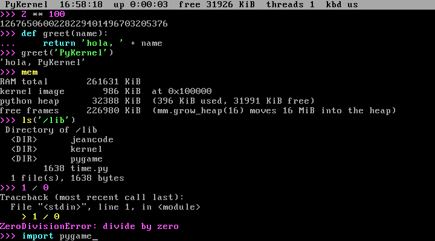
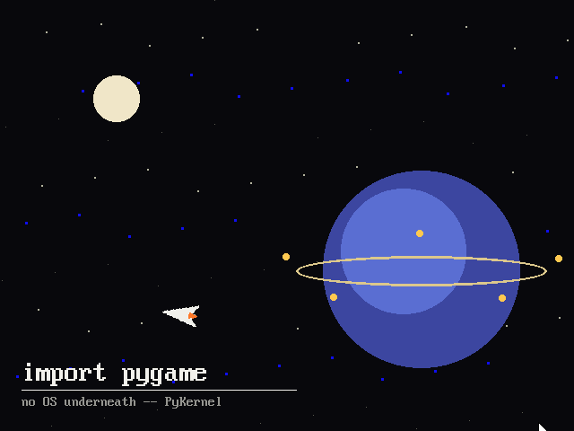
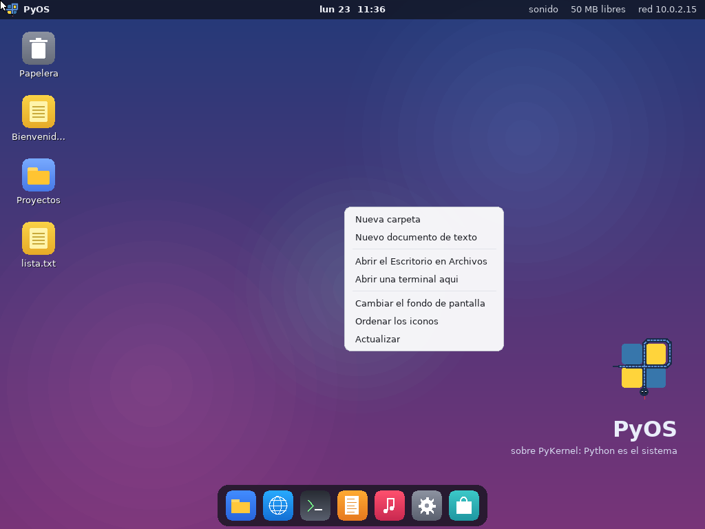
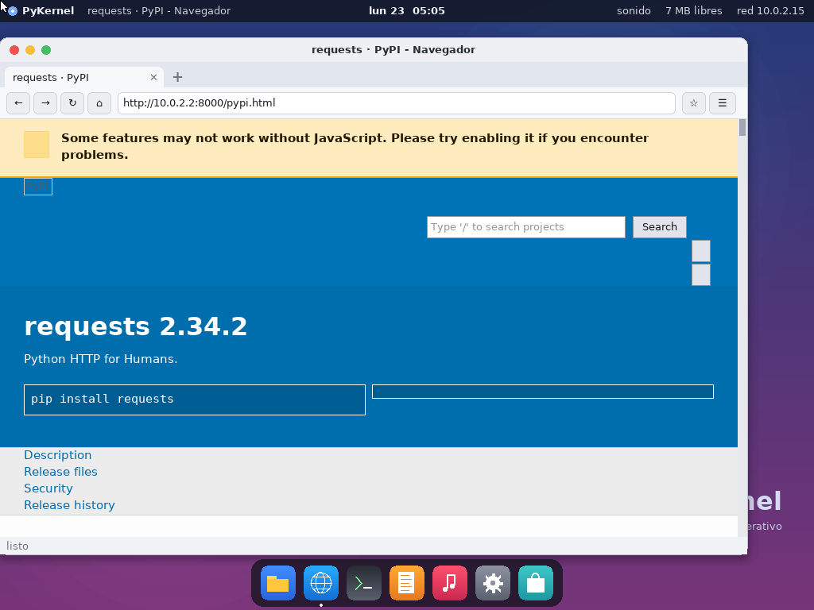
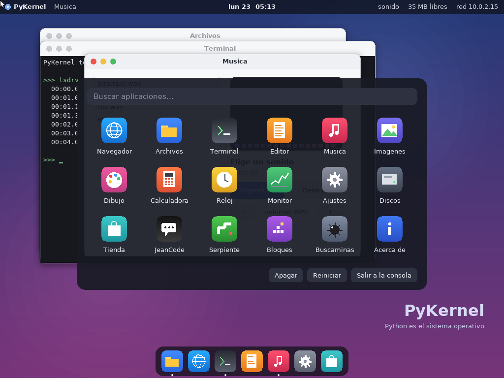

<div align="center">



<br>

# PyKernel — boot a PC straight into `>>>`

**The drivers, the memory manager, the scheduler and the shell are Python you can read and change.**<br>
An x86_64 kernel with no OS underneath: ~1,200 lines of Rust bring the CPU up, a MicroPython VM starts, and everything after that is Python.

[](#02--quick-start)
[](https://github.com/jeancodeeer/PyKernel/releases/latest)
[](https://github.com/micropython/micropython)
[](LICENSE)

**`ENGLISH`** · [`ESPAÑOL`](PYKERNEL.es.md)

</div>

```
N° 002 — PYKERNEL                                                     REF. 0.1
x86_64 · ~1,200 lines of Rust, then Python all the way up. Boots in QEMU.
MicroPython, not CPython · pygame-compatible subset, not pygame · QEMU-tested, not hardware-tested
```

<p align="center">
  
  <br><sub>The console right after boot, in QEMU: plain Python, a block typed over two lines, DOS-style commands (<code>mem</code>, <code>ls</code>) and an error that shows the line that failed. The top row is the kernel's status bar.</sub>
</p>

<br>

> **PyKernel and PyOS are two things.** This repository holds both: **PyKernel** (`pyfs/`) is the kernel — boot, drivers, memory, network, processes, the `>>>` console — and it runs on its own. **PyOS** (`pyos/`) is the operating system people use on top of it: the desktop, the apps (all `.py` files with pygame), the web browser, fonts and sounds. See [pyos/README.md](pyos/README.md) (in Spanish).
>
> 

## 01 — WHAT IT IS

Turn the machine on. No Windows, no Linux, no shell script: GRUB loads the kernel, a few hundred lines of Rust switch the CPU to 64-bit mode and start a Python interpreter, and you are at a `>>>` prompt **that is the operating system**.

Every piece above that is a `.py` file:

- the **drivers** — screen, keyboard and mouse, timer, interrupt controller, clock, PCI, IDE disk, serial ports, graphics;
- the **memory manager** — physical frames and x86_64 page tables, read and edited from Python;
- **preemptive threads**, background tasks, a **FAT filesystem** on the disk;
- the **console**, a full-screen **text editor**, DOS-style **commands**, and a **pygame-compatible graphics API**.

You change them without a compiler: edit, boot again (or `Ctrl-D` to restart the Python world in place).

<p align="center">
  
  <br><sub><code>run('/lib/pygame/examples/showcase.py')</code> — pygame-style code drawing straight to the video card, 30 frames per second, no operating system below it.</sub>
</p>

<p align="center">
  
  
  
  
  <br><sub><code>desktop</code>: windows, a task bar and apps in pygame — and a web browser written in Python rendering PyPI's real HTML and CSS.</sub>
</p>

<br>

## 02 — QUICK START

You only need [QEMU](https://www.qemu.org/download/) (`winget install SoftwareFreedomConservancy.QEMU` · `brew install qemu` · `sudo apt install qemu-system-x86`). No build, no compiler.

| YOU WANT | DO THIS |
|---|---|
| **To try it** (seconds to `>>>`) | Download [`pykernel.iso`](https://github.com/jeancodeeer/PyKernel/releases/latest/download/pykernel.iso), then:<br>`qemu-system-x86_64 -cdrom pykernel.iso -m 512M` |
| **Files that survive power-off** | Create a blank disk once — `qemu-img create -f raw disk.img 32M` — and boot with it:<br>`qemu-system-x86_64 -cdrom pykernel.iso -drive file=disk.img,format=raw -boot d -m 256M`<br>It is formatted (FAT) on first boot and mounted at `/disk`. |
| **To hack on it** | Clone this repo and see [08 — BUILD IT YOURSELF](#08--build-it-yourself). |

Then, at the prompt:

```python
>>> help                                   # every command, one line each
>>> ls('/lib/kernel')                      # the kernel's own source
>>> edit('/lib/kernel/keyboard.py')        # read (and change) a driver, full screen
>>> run('/lib/pygame/examples/bounce.py')  # a small game: arrows or mouse; Esc quits
>>> kbd('es')                              # Spanish keyboard (also 'latam', 'us')
```

Without `-drive`, everything lives in RAM and is gone at power-off.

<br>

## 03 — WHAT IT'S FOR

It is not a daily-driver OS. It is a computer you can **read**: the parts textbooks describe, written in the language most people learn first.

| YOU CAN | HOW |
|---|---|
| **See how a driver really talks to hardware** | `edit('/lib/kernel/ata.py')`: the whole IDE disk driver is one short Python class — pick a sector, wait for the drive, move 512 bytes through an I/O port. |
| **Poke at page tables while the machine runs** | `mm.translate(0xB8000)` walks the four levels of the x86_64 page tables; `mm.map_page(...)` adds a mapping and you can use it on the next line. |
| **Change how the keyboard behaves, live** | `keyboard.bind('f2', lambda: print('hi'))`, switch layouts with `kbd('es')`, or edit `keyboard.py` and press `Ctrl-D`. |
| **Watch interrupts and threads** | `irqs` counts interrupts per line; `thread.start(fn)` runs real preemptive threads; `ps`, `kill(id)`. |
| **Teach OS internals without C** | Interrupts, timers, scheduling, paging and filesystems, each in a file you can open in class. |
| **Make little games on bare metal** | `import pygame` — a pygame 2-compatible subset with keyboard, mouse, fonts, images and sprites. |

<br>

## 04 — WHAT'S INSIDE

| | |
|---|---|
| **Console** | A Python REPL that behaves like CPython 3.13's: its banner, `sys.ps1` / `sys.ps2`, `_`, whole blocks edited as one (Up brings a block back), `exit` / `quit`, F1 help, F2 history, F3 paste mode, coloured prompt and errors. Syntax colouring as you type, Tab completion, Ctrl-R history search, history saved on disk. Errors show the source line that failed. |
| **Commands** | `ls cat more find sort tree copy move rm mkdir cd pwd write edit run mem ps kill irqs lspci date uptime dmesg history kbd keys alias cls ver reboot poweroff` — type the bare name DOS-style, `ls['/lib']` for arguments, `ls > 'out.txt'`, `ls | find['boot']`. |
| **Editor** | `edit('file.py')`: full screen, Python colouring, auto-indent, find, go to line, cut/paste lines. |
| **Screen & keyboard** | VGA text console with ANSI 16/256 colours, 500-line scrollback, status bar, UTF-8 (ñ, á, box drawing). US, Spain and Latin-American layouts generated from the X11 keyboard files, AltGr and dead keys. PS/2 mouse. |
| **pygame-compatible API** | `Surface`, `Rect`, `Color`, `display`, `draw`, `event`, `key`, `mouse`, `time`, `font`, `image` (BMP, PNG), `transform`, `sprite`, `mixer`. Pixels drawn by a small C module. Ctrl+Q posts `QUIT` (there is no window to close). |
| **Threads & tasks** | Preemptive kernel threads behind the standard `_thread` module; generator tasks stepped by the timer; `kill` and Ctrl-C per thread, with disk writes protected from being cut in half. |
| **Storage** | IDE/ATA disk driver, FAT filesystem at `/disk` (readable on any other computer), `/disk/autoexec.py` at boot, `/disk/lib` on the import path. |
| **Network** | virtio-net and e1000 drivers in Python and a full TCP/IP stack in `/lib/kernel/net.py`: Ethernet, ARP, IPv4, ICMP, UDP, TCP (retransmission, windows, servers with `listen`/`accept`), DHCP and DNS. The standard `socket` module on top. Commands `ifconfig ping netstat nslookup wget curl`. |
| **HTTPS** | TLS 1.3 written in Python (`/lib/ssl.py`): X25519, ChaCha20-Poly1305, RSA and ECDSA certificates checked against Mozilla's roots. `http.client`, `urllib.request` and a small `requests`. |
| **Desktop** | `desktop`: a boot splash, a login screen (when accounts have passwords), a top bar, a dock and a launcher with search, rounded windows with shadows, smooth DejaVu fonts — all drawn with pygame. Apps: Python terminal, files, editor, web browser, system monitor, settings, disks and installer, package store, calculator, paint, images (PNG, BMP, GIF, JPEG), clock and calendar, three games, and a music player. |
| **Web browser** | Written in Python (`/lib/browser`): HTML, CSS (selectors, cascade, `@media`), tables, lists, images, forms, tabs, bookmarks, history, cookies, find in page, view source. No JavaScript. `browse('https://…')`. |
| **System** | Processes with PID, parent, arguments, environment, signals and exit codes (`procs start pkill`); `/dev` and `/proc`; users with PBKDF2 passwords (`useradd su passwd`); boot services that restart, and a `crontab`; a package manager, `pkg` (micropython-lib's index and GitHub). |
| **Drivers** | All in Python: disks IDE, SATA (AHCI), NVMe and USB sticks; network virtio-net, e1000 and RTL8139; USB keyboards and mice (xHCI); AC'97 sound with `pygame.mixer` playing WAV files; Bochs/QEMU graphics. `lsdrv` shows which driver has each device. |
| **Hardware** | ACPI (real power-off and reset), local APIC, I/O APIC and HPET, SATA disks through AHCI as well as IDE, MBR partitions. `cpus('start')` wakes the other CPU cores with INIT-SIPI (they are counted and parked: Python runs on one core). `serve('/dir', 80)` is an HTTP server, `ntpdate` sets the clock. |
| **JeanCode** | `jeancode` (or its icon in the launcher) opens [JeanCode](https://github.com/jeancodeeer/JeanCode), my AI chat client, full screen. With a network card it talks HTTPS directly through the kernel's own TCP/IP and TLS; without one it falls back to the serial bridge — see [05](#05--how-it-works). |

<br>

## 05 — HOW IT WORKS

```
+--------------------------------------------------------------+
|  >>>  console, commands, editor, pygame, JeanCode            |  pyfs/lib/kernel/repl.py, shell.py
|  drivers: VGA console, PS/2 keyboard + mouse, video, serial, |  pyfs/lib/kernel/*.py
|  PIC, PIT, RTC, PCI, ATA; frames, page tables, threads       |  (~4,200 lines of Python)
|  RAM filesystem, boot sequence                               |  pyfs/init.py
+--------------------------------------------------------------+
|  MicroPython VM (C)        + _kernel / _gfx bindings         |  mpy/
+--------------------------------------------------------------+
|  Rust: long mode, paging, IDT + interrupt dispatch, context  |  rust/  (~1,200 lines)
|  switch, port / MSR / CR primitives, heap, VM start-up       |
+--------------------------------------------------------------+
```

**Rust** does only what Python physically cannot: enter 64-bit mode, install the interrupt table, switch thread stacks, and expose the CPU's raw instructions (`in`/`out`, MSRs, control registers, `cpuid`, `rdtsc`). Each interrupt is counted and handed to the Python handler registered for it; a CPU fault while Python runs becomes a Python exception instead of a crash.

**C** binds MicroPython to that layer (`_kernel`: port I/O, interrupts, threads, console plumbing) and draws pixels for pygame (`_gfx`). MicroPython v1.25.0 is used as released plus one small patch in `mpy/patches/`.

**Python** is the kernel: `boot.py` brings the machine up in an order you can change, and every driver is ordinary code using `inb`/`outb` and `uctypes.bytearray_at(address, size)` for memory.

**JeanCode without a network card:** each request goes out of COM2 as one JSON line; `tools/jeancode_bridge.py` on the host makes the HTTPS call and streams the answer back. `python tools/run.py` wires it up for you. With the ISO, start QEMU with `-serial vc -serial tcp:127.0.0.1:4555,server=on,wait=off` and run `PYTHONPATH=pyfs/lib python tools/jeancode_bridge.py --connect 127.0.0.1:4555` from a clone of this repo. The bridge logs only method and host.

<br>

## 06 — HONEST LIMITS

| WHAT | IN PLAIN WORDS |
|---|---|
| **Engine** | MicroPython, not CPython. The console feels like CPython's, but there is no `pip`: small pure-Python modules can be copied in and often run; packages built on C extensions cannot. |
| **pygame** | A compatible subset written for this kernel, not the real pygame (that needs SDL and CPython). No sound: `mixer` accepts every call and plays nothing. |
| **Where it runs** | Tested only in QEMU. Real PCs may not boot it. Graphics need the Bochs-style display adapter that QEMU, Bochs and VirtualBox provide. |
| **Hardware** | One CPU core runs Python. Drivers exist for the devices QEMU and VirtualBox emulate (and older PCs); no Wi-Fi, no Intel HD Audio, no USB hubs, only boot-protocol USB keyboards and mice. |
| **Browser** | No JavaScript: pages that need it to show anything come out incomplete. One font (8×16), partial CSS (no real floats, `position` or grid), no progressive JPEG, WebP or SVG. Big pages take seconds to lay out. |
| **Safety** | Everything runs with full privileges (ring 0). Processes get their own namespace and their own memory through `mm.AddressSpace`, but there is no hardware isolation: one process can read or break another. The TLS code is not constant-time. That is the point of a lab, and the reason not to trust it with data. |
| **Persistence** | Only `/disk` survives power-off. "Install" (the Disks app) copies `/lib`, `/bin` and `/etc` to `/disk/system`, which comes first on the import path; booting still needs GRUB from the CD or ISO. |
| **JeanCode** | API keys you type in JeanCode are saved in **plain text** in `/disk/jeancode/`. |

> ⚠️ **On a real PC:** the disk driver writes to the first IDE/ATA disk it finds. Boot it only on a machine with no disk you care about, or with the disks disconnected.

<br>

## 07 — HELP WANTED

- **Run it on real hardware** and tell us what happened — there is a [Hardware report](../../issues/new?template=hardware-report.md) template; a photo of the screen is perfect.
- **Drivers**: Intel HD Audio, USB hubs, Wi-Fi, VBE/GOP graphics set up by the boot loader, testing on real hardware.
- **Multicore** (the other cores through INIT-SIPI), **user mode** (ring 3) and hardware process isolation.
- **Browser**: JavaScript, scalable fonts, floats and `position`.

<br>

## 08 — BUILD IT YOURSELF

Windows + WSL (Ubuntu) today; Linux works the same without the `wsl` hop.

| NEED | |
|---|---|
| Rust | `rustup target add x86_64-unknown-none` and `rustup component add llvm-tools` |
| In WSL / Linux | `sudo apt install build-essential python3 qemu-system-x86` (+ `qemu-system-gui` for a window, `grub-pc-bin xorriso mtools` for the ISO) |
| MicroPython | fetched automatically (git submodule, v1.25.0) |

```
git clone https://github.com/jeancodeeer/PyKernel && cd PyKernel
python tools/build.py          # MicroPython VM (in WSL) -> Rust kernel -> build/kernel.bin + build/pyfs.img
python tools/run.py            # boot; the console in this terminal (Ctrl-A X quits)
python tools/run.py --screen   # the PC screen and keyboard in a window
python tools/test.py           # 89 headless checks in QEMU: keys, screen, disk, power-cycle, pygame
python tools/test_net.py       # network, HTTP and TLS 1.3 against servers on this host
python tools/test_desktop.py   # every desktop app, and the browser on a test site
python tools/iso.py            # build/pykernel.iso, bootable from CD or USB
```

Editing Python needs no compile: change `pyfs/` and run again. Start reading at [CONTRIBUTING.md](CONTRIBUTING.md), which has a short tour of the source.

<br>

## 09 — LICENSE

[MIT](LICENSE). MicroPython is MIT too ([notice](pyfs/licenses/MicroPython.txt), also inside the image at `/licenses`); see [THIRD_PARTY.md](THIRD_PARTY.md).

<div align="center">

<br>

If PyKernel taught you something about how computers work, a ⭐ helps other people find it.

```
JEANCODER © 2026 — RUST ■ MICROPYTHON ■ PYTHON
```

</div>
