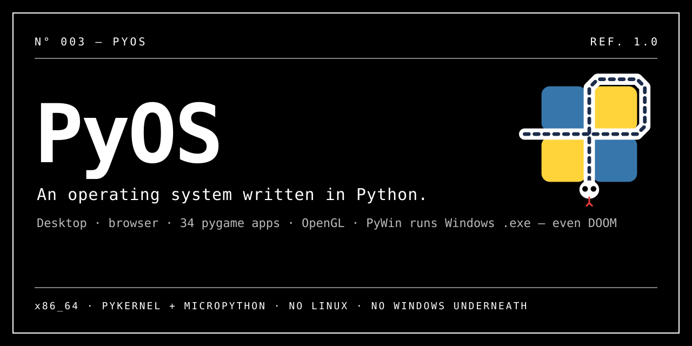
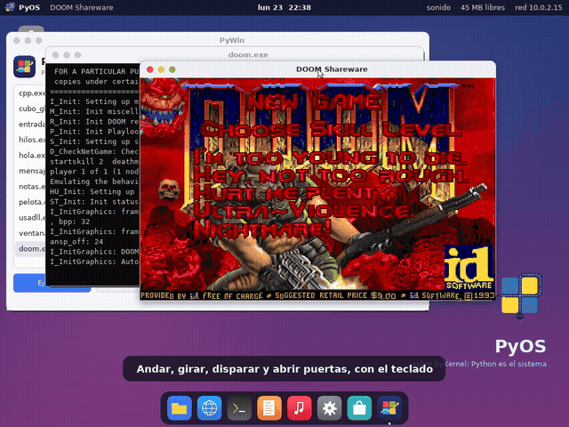
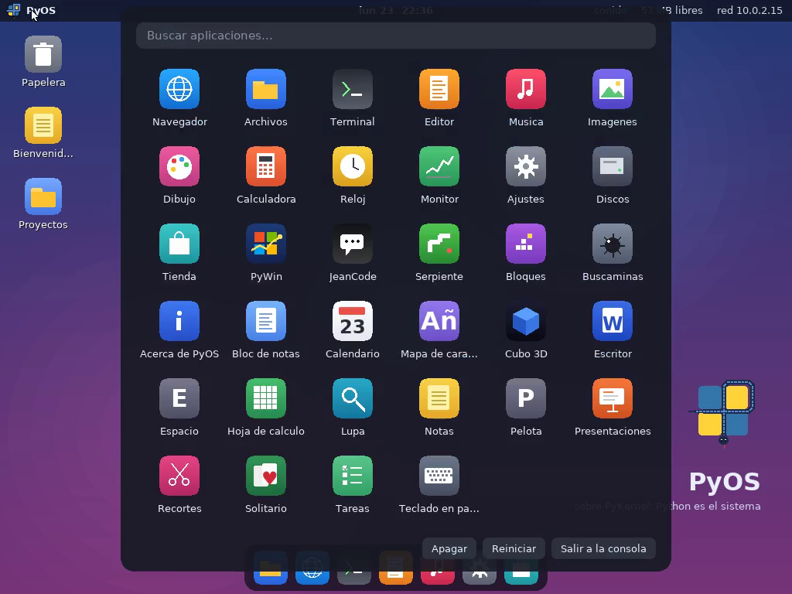
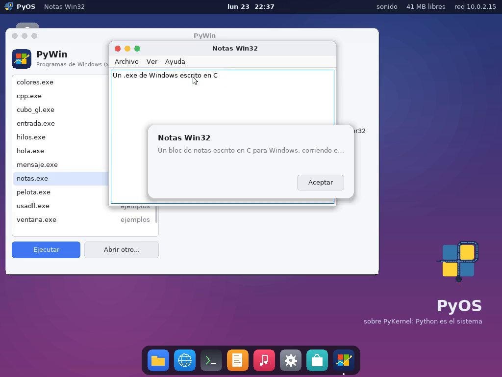
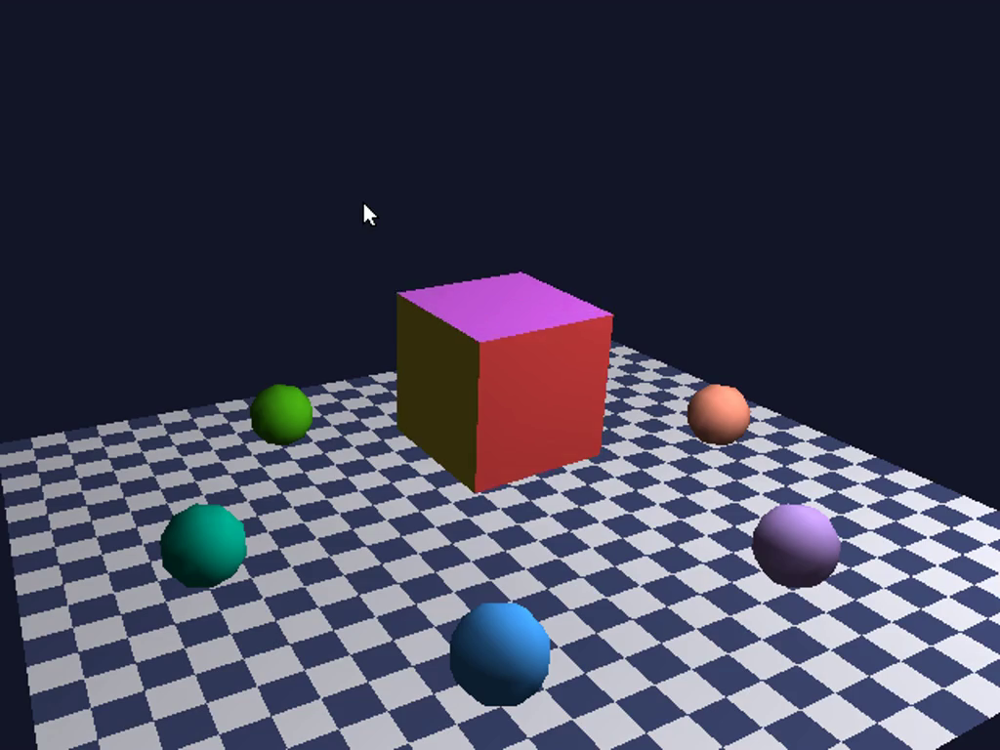
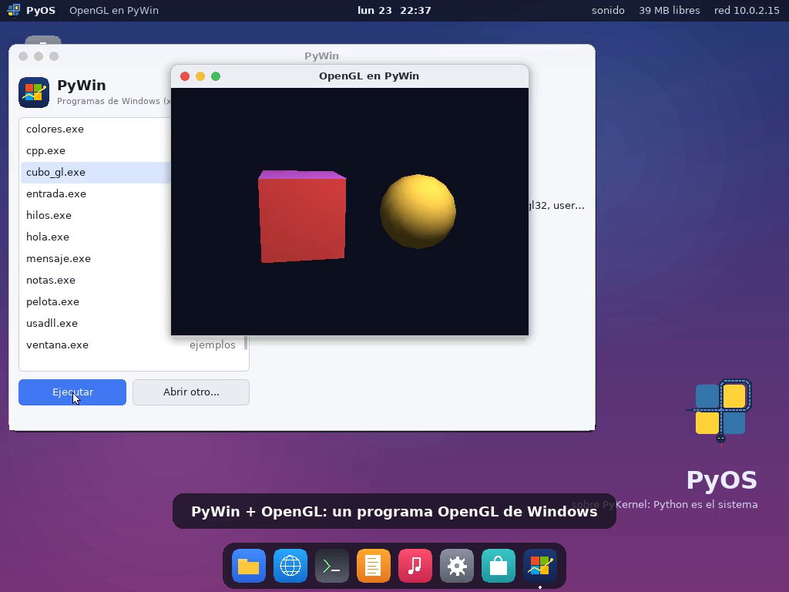
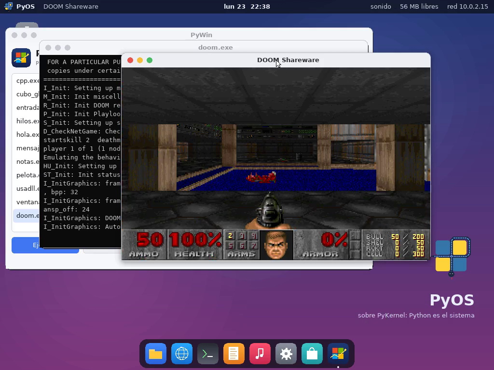

<div align="center">



<br>

# PyOS — un sistema operativo escrito en Python

**Un escritorio, un navegador web, 34 apps, OpenGL y PyWin: archivos `.exe` de Windows ejecutándose de forma nativa, DOOM incluido.**<br>
Arranca en un PC x86_64 sin nada debajo: ni Linux ni Windows, solo [PyKernel](PYKERNEL.es.md), unos cientos de líneas de Rust que ponen en marcha MicroPython. Todo lo que ves es Python que puedes leer y cambiar.

[](https://github.com/jeancodeeer/PyOS/releases/latest)
[](docs/video/pyos-demo.mp4)
[](PYKERNEL.es.md)
[](LICENSE)

[`ENGLISH`](README.md) · **`ESPAÑOL`**

</div>

```
N° 003 — PYOS                                                         REF. 1.0
x86_64 · PyKernel + MicroPython 1.25 · cada driver, ventana y app es un archivo .py
Probado en QEMU, no en hardware · MicroPython, no CPython · compatible con pygame, no el pygame de SDL
```

<p align="center">
  
  <br><sub>DOOM en PyOS. El episodio shareware de Internet Archive, compilado para Windows x64 desde el código GPL de id Software, ejecutado por <b>PyWin</b>: el código máquina del juego corre en el procesador, y cada función de Windows que usa (<code>CreateWindowExA</code>, <code>PeekMessageA</code>, <code>StretchDIBits</code>…) está escrita en Python.</sub>
</p>

<br>

## 01 — QUÉ ES

Enciendes la máquina. GRUB carga PyKernel, el procesador pasa a 64 bits, arranca un intérprete de Python, y ese intérprete **es** el sistema operativo. PyOS es lo que se usa encima:

- un **escritorio** con ventanas, dock, lanzador, iconos, menús de clic derecho, carpetas, papelera, inicio de sesión y fondos;
- **34 apps**, cada una un archivo `.py` que dibuja con pygame: un navegador web con su propio motor HTML/CSS, archivos, terminal, editor de código, música, dibujo, juegos, y las apps de Windows de todos los días hechas de nuevo (Bloc de notas, procesador de textos, hoja de cálculo, presentaciones, Solitario…);
- **OpenGL 1.x** dibujado por software, con los nombres de PyOpenGL: los programas PyOpenGL + pygame funcionan sin cambios;
- **PyWin**, un pequeño Wine: carga programas de Windows x64 y los ejecuta, de consola y con ventanas, con hilos, DLL, excepciones de C++, OpenGL… y DOOM.

<p align="center">
  
  
  <br>
  
  
  <br><sub>El lanzador · un programa Win32 con su menú y su diálogo · OpenGL desde Python · OpenGL desde un <code>.exe</code> de Windows.</sub>
</p>

<br>

## 01b — PARA QUÉ SIRVE, Y PARA QUÉ NO

Hay sistemas operativos escritos en lenguajes de alto nivel (Singularity en C#, Redox en Rust, las máquinas Lisp). PyOS se pregunta algo más concreto: *¿y si cada capa que ves fuera Python que alguien que empieza pudiera abrir y leer?*

| SI QUIERES… | PYOS |
|---|---|
| ver cómo funcionan por dentro un escritorio, un navegador o Wine | Cada uno son unos pocos archivos `.py` legibles: `pyos/lib/desktop/wm.py`, `pyos/lib/browser/`, `pyos/lib/pywin/`. Sin compilar: editas y reinicias. |
| escribir una app | Un archivo `.py` con una cabecera de tres líneas; aparece sola en el lanzador. Ver [el formato de una app](pyos/README.md#formato-de-una-app). |
| ejecutar un programa hecho para Windows | PyWin carga el `.exe` él mismo y tiene kernel32, msvcrt, user32, gdi32, opengl32, advapi32, shell32 y comdlg32 escritas en Python. |
| ejecutar código pygame y PyOpenGL | Trae una biblioteca compatible con pygame y OpenGL 1.x. Los juegos pequeños y los tutoriales clásicos de PyOpenGL funcionan tal cual. |
| una demo que se enseña sola | Escribe `tour()`: un robot abre cada app y la usa con el ratón y el teclado, con subtítulos. Así se hizo [el vídeo](docs/video/pyos-demo.mp4). |

**Límites, con honestidad**
- **Velocidad.** Es Python (MicroPython) de arriba abajo. Los bucles de píxeles usan viper (el código nativo de MicroPython), pero QEMU sin KVM mueve la demo 3D a pocos fotogramas por segundo.
- **Hardware.** Probado en QEMU. Hay drivers para dispositivos reales (AHCI, NVMe, USB xHCI, e1000, RTL8139, virtio, AC'97), pero PyOS no se ha probado en muchos PCs reales.
- **PyWin** solo ejecuta programas de 64 bits. Los hilos son reales pero se turnan. No hay DirectX, ni red de Windows (`ws2_32`), ni cuadros de diálogo desde recursos. Un programa que calcula sin llamar a Windows retiene el escritorio hasta que lo hace.
- **Python** es MicroPython 1.25, no CPython: las extensiones en C (numpy…) no se cargan.
- **El navegador** dibuja HTML y CSS, pero no ejecuta JavaScript.

## 02 — EMPEZAR

| TIENES | HAZ ESTO |
|---|---|
| **QEMU** | Descarga `pyos-1.0.iso` de [Releases](https://github.com/jeancodeeer/PyOS/releases/latest), ejecuta `qemu-system-x86_64 -m 768 -cdrom pyos-1.0.iso -nic user,model=virtio-net-pci -device AC97` y escribe `desktop` (o `tour()` para el tour guiado). |
| **Un pendrive** | Graba la ISO con Rufus (modo DD), balenaEtcher o `dd` y arranca en modo BIOS / CSM. |
| **El código fuente** | `python tools/build.py && python tools/run.py` (ver [Compílalo tú](#07--compílalo-tú)). |

En el prompt `>>>` todo es Python. Algunos comandos: `desktop`, `tour()`, `lsdrv`, `ifconfig`, `ping('10.0.2.2')`, `procs`, `ls('/apps')`, y `pyos_autostart(True)` para arrancar directamente en el escritorio.

## 03 — QUÉ TRAE

| PIEZA | QUÉ HACE | DÓNDE |
|---|---|---|
| **Escritorio** | Ventanas, dock, lanzador, iconos, menús de clic derecho, carpetas, papelera, inicio de sesión, fondos, subtítulos | `pyos/lib/desktop/` |
| **Apps integradas** | Navegador, Archivos, Terminal, Editor, Música, Imágenes, Dibujo, Calculadora, Reloj, Monitor, Ajustes, Discos, Tienda, PyWin, JeanCode, Serpiente, Bloques, Buscaminas, Acerca de | `pyos/lib/desktop/apps/` |
| **Apps estilo Windows** | Bloc de notas, Escritor, Hoja de cálculo, Presentaciones, Solitario, Calendario, Recortes, Mapa de caracteres, Teclado en pantalla, Lupa, Notas, Tareas | `pyos/apps/` (un `.py` cada una) |
| **Navegador web** | Analizador HTML, cascada y maquetación CSS, imágenes, formularios, pestañas, marcadores, HTTPS con su propio TLS 1.3 | `pyos/lib/browser/` |
| **OpenGL** | `OpenGL.GL`, `OpenGL.GLU`, `OpenGL.GLUT`: matrices, z-buffer, luces, texturas con perspectiva, listas de visualización | `pyos/lib/OpenGL/` |
| **PyWin** | Programas de Windows x64, ver abajo | `pyos/lib/pywin/` |
| **PyKernel** | Arranque, memoria, hilos, PCI, discos, USB, red (TCP/IP, DNS, DHCP, TLS), sonido, la consola `>>>` | `pyfs/`, `rust/`, `mpy/` — [PYKERNEL.es.md](PYKERNEL.es.md) |

## 04 — PYWIN: PROGRAMAS DE WINDOWS EN PYOS

Haz doble clic en un `.exe`, o abre la app **PyWin**: lista los programas que encuentra y, antes de ejecutar uno, dice si PyWin tiene todas las funciones de Windows que usa.

Cómo funciona, en cuatro archivos:

1. **`pe.py`** lee el `.exe` (PE32+): secciones, reubicaciones, importaciones, exportaciones y recursos.
2. **`cpu.py`** escribe, con un mini ensamblador legible, el código máquina que pasa de Python al programa y vuelve. Cada función importada se convierte en un *thunk*: guarda los registros y vuelve a Python con su número.
3. **`process.py`** le da al programa una pila, un TEB/PEB (a través del registro GS) e hilos; Python ejecuta la función de Windows y salta de vuelta.
4. **`dlls/*.py`** son las DLL: `kernel32` (archivos, memoria, hilos, eventos, mutex, TLS, carga de DLL), `msvcrt` (`printf`, `scanf`, `malloc`…), `user32` (ventanas, mensajes, menús, controles), `gdi32` (dibujo), `opengl32`/`glu32`, `advapi32` (un registro guardado en un JSON), `shell32` y `comdlg32`. El `throw`/`catch` de C++ funciona: `seh.py` recorre la pila con las tablas `.pdata` del propio programa.

Hay ejemplos con su código C/C++ en [`pyos/share/pywin/ejemplos`](pyos/share/pywin/ejemplos): un programa de consola, `scanf`, STL y excepciones de C++, hilos, una DLL propia, colores en la consola y el registro, ventanas Win32 con GDI, un bloc de notas con recursos y diálogos, y OpenGL.

**DOOM**: `python tools/doom.py` compila un `doom.exe` para Windows x64 a partir de [doomgeneric](https://github.com/ozkl/doomgeneric) (el código GPL de id Software) y descarga el episodio shareware de [Internet Archive](https://archive.org/details/DoomsharewareEpisode). Ninguno de los dos archivos se guarda en este repositorio. Después: `PYOS_EXTRA=build/extra python tools/build.py --fs`.

<p align="center">
  
</p>

## 05 — CÓMO FUNCIONA

```
 apps (.py, pygame)          Navegador · Archivos · Bloc de notas · DOOM.exe (con PyWin) · ...
 PyOS                        desktop/wm.py · pygame · OpenGL · pywin · navegador     ← pyos/
 PyKernel                    drivers · memoria · hilos · TCP/IP · TLS · FAT · >>>     ← pyfs/
 MicroPython 1.25            + código nativo viper para los bucles de píxeles         ← mpy/
 ~1.200 líneas de Rust       modo largo, interrupciones, la memoria de la VM          ← rust/
 PC x86_64 (o QEMU)
```

PyKernel no sabe nada de PyOS: al arrancar ejecuta `/etc/init.d/*.py`, y [`pyos/etc/init.d/50-pyos.py`](pyos/etc/init.d/50-pyos.py) añade los comandos `desktop`, `tour`, `browse`, `apps` e `install_app`. `tools/mkfs.py` superpone los dos árboles en la imagen de arranque; con `PYKERNEL_ONLY=1` se deja fuera PyOS.

## 06 — EL TOUR Y EL VÍDEO

`tour()` abre el escritorio y un robot ([`pyos/lib/pyos/robot.py`](pyos/lib/pyos/robot.py)) que mueve el ratón y escribe por el mismo camino que los dispositivos reales. Abre cada app, la usa, ejecuta los ejemplos de PyWin y juega a DOOM, mientras unos subtítulos explican cada paso ([`pyos/lib/pyos/tour.py`](pyos/lib/pyos/tour.py)).

`python tools/grabar_video.py` lo graba desde el primer instante del arranque (capturas de pantalla de QEMU → ffmpeg) en `build/pyos-demo.mp4`. El resultado: [docs/video/pyos-demo.mp4](docs/video/pyos-demo.mp4), 8 min 46 s.

## 07 — COMPÍLALO TÚ

Necesitas Python 3, Rust (`rustup target add x86_64-unknown-none`, `rustup component add llvm-tools`), gcc y make para la VM de MicroPython, QEMU para ejecutarlo, y `grub-pc-bin xorriso mtools` para la ISO.

```bash
git clone --recursive https://github.com/jeancodeeer/PyOS
cd PyOS
python tools/build.py          # VM de MicroPython + núcleo en Rust + imagen de arranque
python tools/run.py            # arrancar en QEMU
python tools/iso.py            # build/pyos.iso
python tools/test.py           # pruebas del núcleo (89)
python tools/test_desktop.py   # escritorio y apps (16)
python tools/test_pywin.py     # PyWin y OpenGL (13)
```

Si solo has cambiado Python, `python tools/build.py --fs` vuelve a empaquetar los archivos en un segundo. El [flujo de release](.github/workflows/release.yml) genera la ISO de la misma forma.

## 08 — LICENCIA Y CRÉDITOS

MIT, ver [LICENSE](LICENSE). Las partes de terceros (MicroPython, las fuentes DejaVu, los certificados raíz de Mozilla) están en [THIRD_PARTY.md](THIRD_PARTY.md). DOOM no se incluye: `tools/doom.py` lo descarga (código GPL; datos shareware de Internet Archive).

Hecho por [jeancodeeer](https://github.com/jeancodeeer) · también [JeanCode](https://github.com/jeancodeeer/JeanCode) y [Jean-API-Generator](https://github.com/jeancodeeer/Jean-API-Generator).
