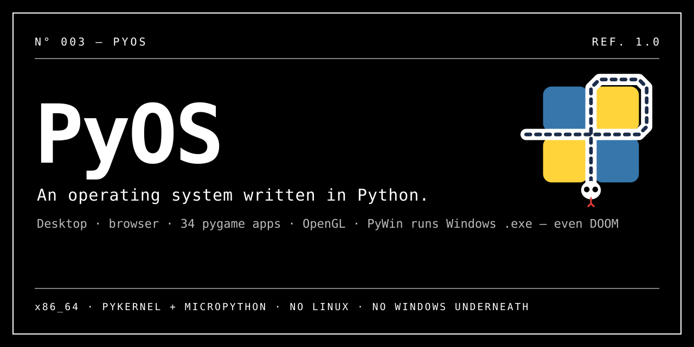
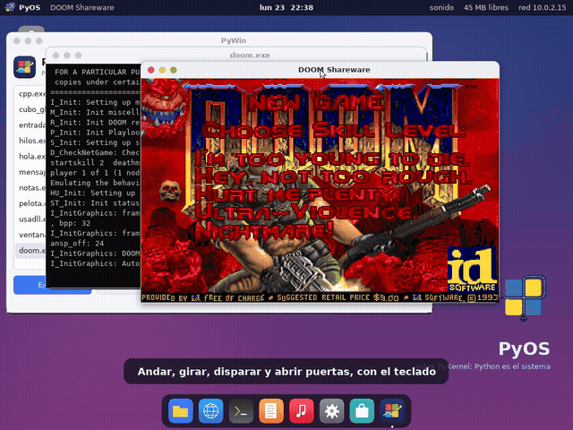
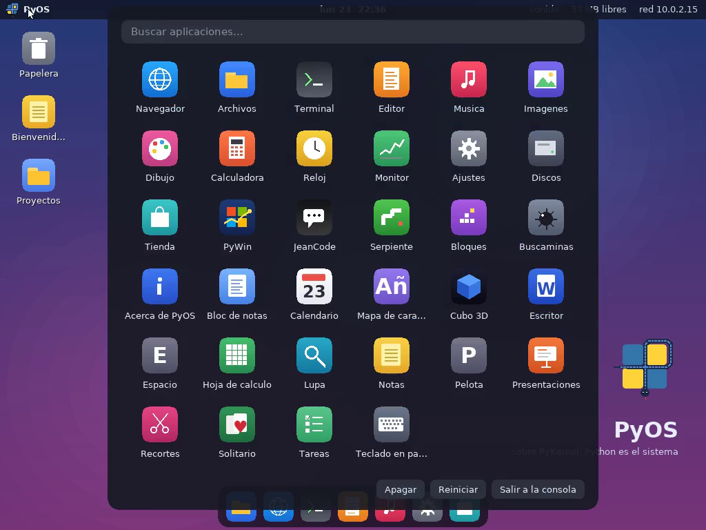
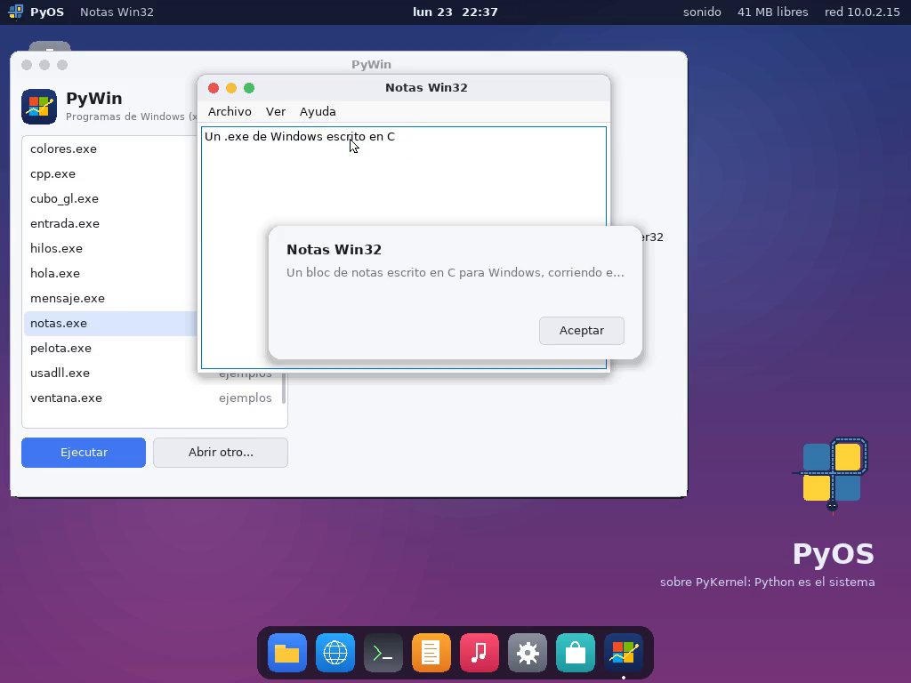
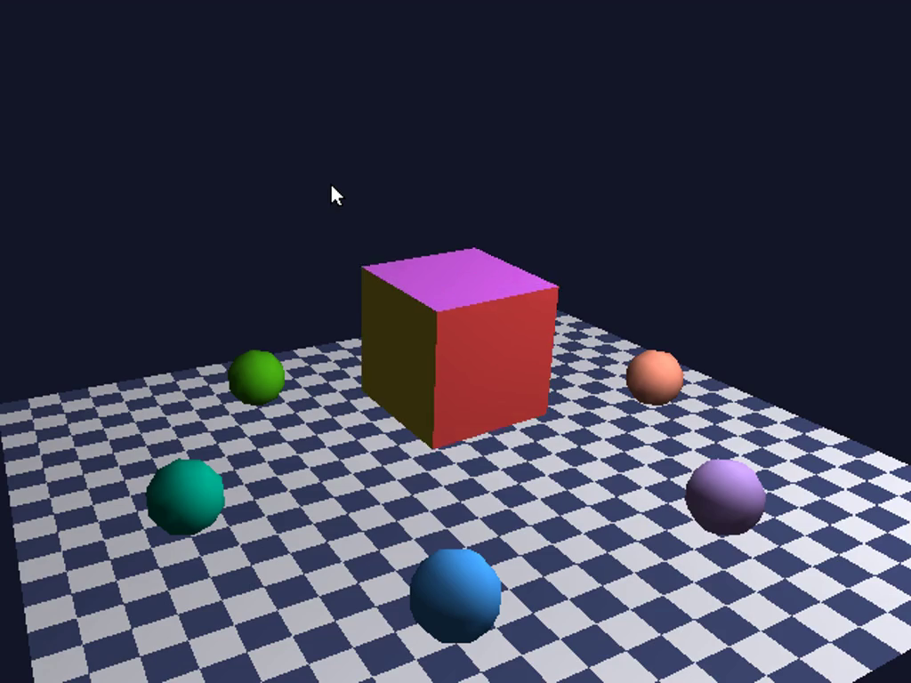
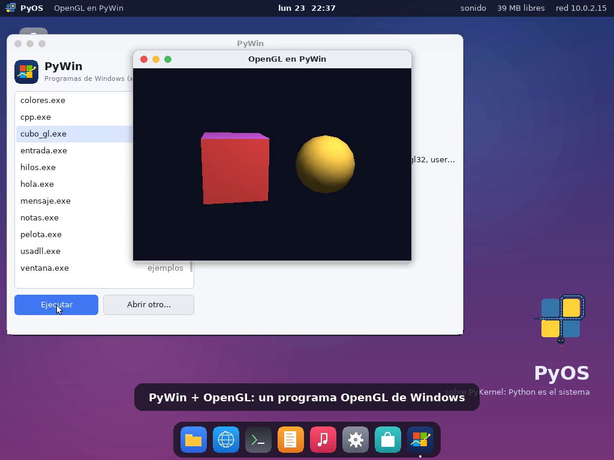
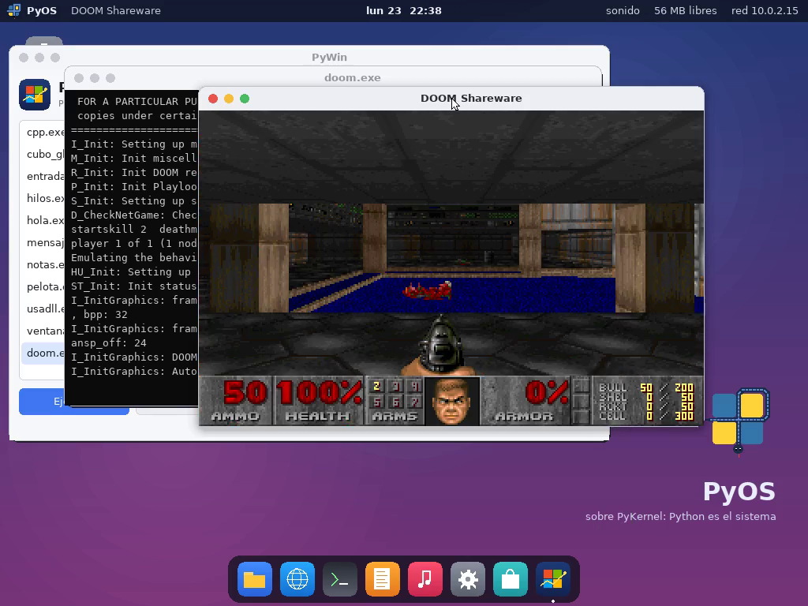

<div align="center">




<br>

# SnakeyOS — an operating system written in Python

**A desktop, a web browser, 34 apps, OpenGL, and PyWin: Windows `.exe` files running natively — DOOM included.**<br>
It boots on a bare x86_64 machine. Under it there is no Linux and no Windows: only [PyKernel](PYKERNEL.md), a few hundred lines of Rust that start MicroPython. Everything you see is Python you can read and change.

[](https://github.com/jeancodeeer/SnakeyOS/releases/latest)
[](docs/video/pyos-demo.mp4)
[](PYKERNEL.md)
[](LICENSE)

**`ENGLISH`** · [`ESPAÑOL`](README.es.md)

</div>

```
N° 003 — SNAKEYOS                                                         REF. 1.0
x86_64 · PyKernel + MicroPython 1.25 · every driver, window and app is a .py file
QEMU-tested, not hardware-tested · MicroPython, not CPython · pygame-compatible, not SDL pygame
```

<p align="center">
  
  <br><sub>DOOM on SnakeyOS. The shareware episode from the Internet Archive, id Software's GPL source built for Windows x64, run by <b>PyWin</b>: the game's own machine code runs on the CPU, and every Windows function it calls (<code>CreateWindowExA</code>, <code>PeekMessageA</code>, <code>StretchDIBits</code>…) is written in Python.</sub>
</p>

<br>

## 01 — WHAT IT IS

Turn the machine on. GRUB loads PyKernel, the CPU goes to 64-bit mode, a Python interpreter starts — and that interpreter **is** the operating system. SnakeyOS is what people use on top of it:

- a **desktop** with windows, a dock, a launcher, desktop icons, right-click menus, folders, a trash can, a login screen and wallpapers;
- **34 apps**, every one a `.py` file drawing with pygame — a web browser with its own HTML/CSS engine, files, terminal, code editor, music, paint, games, and the everyday Windows apps rebuilt (Notepad, a word processor, a spreadsheet, slides, Solitaire…);
- **OpenGL 1.x** drawn by software, with PyOpenGL's names, so PyOpenGL + pygame programs run unchanged;
- **PyWin**, a small Wine: it loads Windows x64 programs and runs them, consoles and windows, threads, DLLs, C++ exceptions, OpenGL — and DOOM.

<p align="center">
  
  
  <br>
  
  
  <br><sub>The launcher · a Win32 program with its menu and dialog · OpenGL from Python · OpenGL from a Windows <code>.exe</code>.</sub>
</p>

<br>

## 01b — WHERE IT FITS, AND WHERE IT DOESN'T

Operating systems written in high-level languages exist (Singularity in C#, Redox in Rust, the Lisp machines). SnakeyOS asks a narrower question: *what if every layer you can see were Python a beginner could open and read?*

| IF YOU WANT… | PYOS |
|---|---|
| to see how a desktop, a browser or Wine work inside | Each is a few readable `.py` files: `pyos/lib/desktop/wm.py`, `pyos/lib/browser/`, `pyos/lib/pywin/`. No build step: edit, reboot. |
| to write an app | One `.py` file with a three-line header; it shows up in the launcher. See [the app format](pyos/README.md#formato-de-una-app). |
| to run a program written for Windows | PyWin loads the `.exe` itself and implements kernel32, msvcrt, user32, gdi32, opengl32, advapi32, shell32 and comdlg32 in Python. |
| to run pygame and PyOpenGL code | A pygame-compatible library and OpenGL 1.x are built in. Small games and the classic PyOpenGL tutorials work as they are. |
| a demo that shows itself | Type `tour()`: a robot opens every app and uses it with the mouse and the keyboard, with subtitles. That is how [the video](docs/video/pyos-demo.mp4) was made. |

**Honest limits**
- **Speed.** It is Python (MicroPython) all the way. Pixel loops use viper (MicroPython's native code), but QEMU without KVM runs the 3D demo at a few frames per second.
- **Hardware.** Tested in QEMU. Drivers exist for real devices (AHCI, NVMe, xHCI USB, e1000, RTL8139, virtio, AC'97), but SnakeyOS has not been tried on many real PCs.
- **PyWin** runs 64-bit programs only. Threads are real but take turns. There is no DirectX, no Windows networking (`ws2_32`) and no dialog boxes from resources. A program that computes without calling Windows holds the desktop until it does.
- **Python** is MicroPython 1.25, not CPython: C extensions (numpy…) do not load.
- **The browser** draws HTML and CSS but does not run JavaScript.

## 02 — QUICK START

| YOU HAVE | DO THIS |
|---|---|
| **A PC, or QEMU** | Download `SnakeyOSx86.iso` from [Releases](https://github.com/jeancodeeer/SnakeyOS/releases/latest), then `qemu-system-x86_64 -m 768 -cdrom SnakeyOSx86.iso -nic user,model=virtio-net-pci -device AC97`. It boots straight into the desktop. |
| **An ARM64 machine** (UEFI) | Download `SnakeyOSARM64.iso`. It runs on QEMU `virt` (`tools/run_arm64.sh`), ARM servers, and Raspberry Pi 4/5 with UEFI firmware. See the [1.2.0 notes](docs/releases/v1.2.0.md). |
| **A USB stick** | Write the ISO with Rufus (DD mode), balenaEtcher or `dd`. On PCs, boot it in BIOS/CSM or UEFI mode; on ARM64, the firmware finds it through UEFI. |
| **The source** | `python tools/build.py && python tools/run.py` (see [Build it yourself](#07--build-it-yourself)). |

At the `>>>` prompt everything is Python. A few commands: `desktop`, `tour()`, `lsdrv`, `ifconfig`, `ping('10.0.2.2')`, `procs`, `ls('/apps')`, `pyos_autostart(True)` to boot straight into the desktop.

## 03 — WHAT'S INSIDE

| PART | WHAT IT DOES | WHERE |
|---|---|---|
| **Desktop** | Windows, dock, launcher, desktop icons, right-click menus, folders, trash, login, wallpapers, subtitles | `pyos/lib/desktop/` |
| **Built-in apps** | Browser, Files, Terminal, Editor, Music, Images, Paint, Calculator, Clock, System Monitor, Settings, Disks, Store, PyWin, JeanCode, Snake, Blocks, Minesweeper, About | `pyos/lib/desktop/apps/` |
| **Windows-style apps** | Notepad, Writer, Spreadsheet, Slides, Solitaire, Calendar, Snipping, Character Map, On-screen Keyboard, Magnifier, Sticky Notes, Tasks | `pyos/apps/` (one `.py` each) |
| **Web browser** | HTML parser, CSS cascade and layout, images, forms, tabs, bookmarks, HTTPS with its own TLS 1.3 | `pyos/lib/browser/` |
| **OpenGL** | `OpenGL.GL`, `OpenGL.GLU`, `OpenGL.GLUT`: matrices, depth buffer, lighting, perspective-correct textures, display lists | `pyos/lib/OpenGL/` |
| **PyWin** | Windows x64 programs, see below | `pyos/lib/pywin/` |
| **PyKernel** | Boot, memory, threads, PCI, disks, USB, network (TCP/IP, DNS, DHCP, TLS), sound, the `>>>` console | `pyfs/`, `rust/`, `mpy/` — [PYKERNEL.md](PYKERNEL.md) |

## 04 — PYWIN: WINDOWS PROGRAMS ON PYOS

Double-click an `.exe`, or open the **PyWin** app: it lists the programs it finds and says, before running one, whether PyWin has every Windows function it uses.

How it works, in four files:

1. **`pe.py`** reads the `.exe` (PE32+): sections, relocations, imports, exports, resources.
2. **`cpu.py`** writes, with a tiny readable assembler, the machine code that switches between Python and the program. Each imported function becomes a *thunk*: it saves the registers and returns to Python with its number.
3. **`process.py`** gives the program a stack, a TEB/PEB (through the GS register) and threads; Python runs the Windows function and jumps back.
4. **`dlls/*.py`** are the DLLs: `kernel32` (files, memory, threads, events, mutexes, TLS, DLL loading), `msvcrt` (`printf`, `scanf`, `malloc`…), `user32` (windows, messages, menus, controls), `gdi32` (drawing), `opengl32`/`glu32`, `advapi32` (a registry kept in a JSON file), `shell32`, `comdlg32`. C++ `throw`/`catch` work: `seh.py` unwinds the stack with the program's own `.pdata` tables.

Examples with their C/C++ source are in [`pyos/share/pywin/ejemplos`](pyos/share/pywin/ejemplos): a console program, `scanf`, C++ STL and exceptions, threads, a DLL of its own, console colours and the registry, Win32 windows with GDI, a notepad with resources and dialogs, and OpenGL.

**DOOM**: `python tools/doom.py` builds a Windows x64 `doom.exe` from [doomgeneric](https://github.com/ozkl/doomgeneric) (id Software's GPL source) and downloads the shareware episode from the [Internet Archive](https://archive.org/details/DoomsharewareEpisode). Neither file is kept in this repository. Then build with `PYOS_EXTRA=build/extra python tools/build.py --fs`.

<p align="center">
  
</p>

## 05 — HOW IT WORKS

```
 apps (.py, pygame)          Browser · Files · Notepad · DOOM.exe (via PyWin) · ...
 SnakeyOS                        desktop/wm.py · pygame · OpenGL · pywin · browser       ← pyos/
 PyKernel                    drivers · memory · threads · TCP/IP · TLS · FAT · >>>    ← pyfs/
 MicroPython 1.25 VM         + viper native code for the pixel loops                  ← mpy/
 ~1,200 lines of Rust        long mode, interrupts, the VM's heap                     ← rust/
 x86_64 PC (or QEMU)
```

PyKernel knows nothing about SnakeyOS: at boot it runs `/etc/init.d/*.py`, and [`pyos/etc/init.d/50-pyos.py`](pyos/etc/init.d/50-pyos.py) adds the `desktop`, `tour`, `browse`, `apps` and `install_app` commands. `tools/mkfs.py` lays the two trees over each other in the boot image; `PYKERNEL_ONLY=1` leaves SnakeyOS out.

## 06 — THE TOUR AND THE VIDEO

`tour()` starts the desktop and a robot ([`pyos/lib/pyos/robot.py`](pyos/lib/pyos/robot.py)) that moves the mouse and types through the same path as the real devices. It opens every app, uses it, runs the PyWin examples and plays DOOM, while subtitles explain each step ([`pyos/lib/pyos/tour.py`](pyos/lib/pyos/tour.py)).

`python tools/grabar_video.py` records it from the first instant of the boot (QEMU screen dumps → ffmpeg) into `build/pyos-demo.mp4`. The result: [docs/video/pyos-demo.mp4](docs/video/pyos-demo.mp4), 8 min 46 s.

## 07 — BUILD IT YOURSELF

You need Python 3, Rust (`rustup target add x86_64-unknown-none`, `rustup component add llvm-tools`), gcc and make for the MicroPython VM, QEMU to run it, and `grub-pc-bin xorriso mtools` for the ISO. For ARM64 you also need `rustup target add aarch64-unknown-none aarch64-unknown-uefi` and `gcc-aarch64-linux-gnu`.

```bash
git clone --recursive https://github.com/jeancodeeer/SnakeyOS
cd SnakeyOS
python tools/build.py          # MicroPython VM + Rust kernel + boot image
python tools/run.py            # boot in QEMU
python tools/iso.py            # build/snakeyos.iso
python tools/build.py --arch aarch64 && python tools/iso.py --arch aarch64   # build/snakeyos-arm64.iso
tools/run_arm64.sh             # boot it in QEMU (qemu-system-arm, qemu-efi-aarch64)
python tools/test.py           # kernel checks (89)
python tools/test_desktop.py   # desktop and apps (16)
python tools/test_pywin.py     # PyWin and OpenGL (13)
python tools/test_fast.py      # the C code ARM64 uses instead of viper == viper
```

After editing only Python, `python tools/build.py --fs` repacks the files in a second. The [release workflow](.github/workflows/release.yml) builds the ISO the same way.

## 08 — LICENSE AND CREDITS

MIT — see [LICENSE](LICENSE). Third-party parts (MicroPython, DejaVu fonts, Mozilla's root certificates) are listed in [THIRD_PARTY.md](THIRD_PARTY.md). DOOM is not included: `tools/doom.py` fetches it (GPL source; shareware data from the Internet Archive).

Made by [jeancodeeer](https://github.com/jeancodeeer) · also [JeanCode](https://github.com/jeancodeeer/JeanCode) and [Jean-API-Generator](https://github.com/jeancodeeer/Jean-API-Generator).
