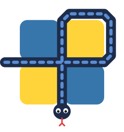

<p align="center"></p>

# SnakeyOS

**SnakeyOS es el sistema operativo; PyKernel es su núcleo.** Son dos cosas separadas en este repositorio:

| | QUÉ ES | DÓNDE |
|---|---|---|
| **PyKernel** | El núcleo: arranque (Rust), MicroPython, drivers, memoria, red, TLS, procesos, consola `>>>`. Funciona solo, sin SnakeyOS. | `pyfs/` |
| **SnakeyOS** | Lo que usa la gente: escritorio, apps, navegador web, fuentes, sonidos, imágenes. | `pyos/` |

Al compilar, `tools/mkfs.py` superpone los dos árboles en la imagen de arranque (`pyos/lib/desktop` acaba en `/lib/desktop`). Con `PYKERNEL_ONLY=1 python tools/build.py --fs` se obtiene el núcleo solo.

PyKernel no sabe nada de SnakeyOS. Al arrancar ejecuta `/etc/init.d/*.py`, y SnakeyOS se engancha con `pyos/etc/init.d/50-pyos.py`, que añade los comandos `desktop`, `browse`, `jeancode`, `apps`, `install_app` y `pyos_autostart`.

Al encender, SnakeyOS arranca directo en el escritorio, como cualquier sistema: animación de arranque, en el primer arranque la creación de tu cuenta (la primera es administradora), la pantalla de usuarios con contraseña y la bienvenida. Desde el menú de inicio: Bloquear, Cerrar sesión, Consola, Reiniciar y Apagar. Para arrancar en la consola de texto: la segunda entrada de GRUB ("consola de texto"), `-append console` en QEMU, o `pyos_autostart(False)`.

## Todo es Python con pygame

Todas las aplicaciones son archivos `.py` que dibujan con pygame:

- **Incluidas en el escritorio** (`pyos/lib/desktop/apps/`): Navegador, Archivos, Terminal, Editor, Música, Imágenes, Dibujo, Calculadora, Reloj, Monitor, Ajustes, Discos, Tienda, PyWin, JeanCode, Serpiente, Bloques, Buscaminas y Acerca de.
- **Apps en archivos sueltos** (`pyos/apps/`, en `/apps`): Notas, Hoja de cálculo, Tareas, Pelota, Espacio y Cubo 3D (OpenGL).

### Las aplicaciones de Windows más usadas, hechas en pygame

Cada una es una app propia, con nombre genérico y diseño propio:

| EN WINDOWS | EN SnakeyOS | QUÉ HACE |
|---|---|---|
| Bloc de notas | **Bloc de notas** (`bloc.py`) | Menús Archivo/Editar/Formato, abrir y guardar, buscar (F3) y reemplazar, ajuste de línea, fecha y hora (F5), zoom. Abre los `.txt`. |
| WordPad / Word | **Escritor** (`escritor.py`) | Títulos, subtítulos, negrita, alineación y colores por párrafo; guarda HTML, que se abre en el navegador. |
| Excel | **Hoja de cálculo** (`hoja.py`) | Celdas con fórmulas en Python (`=A1*2`, `=sum(A1:A5)`); guarda CSV. |
| PowerPoint | **Presentaciones** (`presentaciones.py`) | Diapositivas con título y viñetas, 4 temas, reordenar; modo presentación a pantalla completa (F5). |
| Solitario | **Solitario** (`solitario.py`) | Klondike con arrastrar y soltar, doble clic para subir una carta a su pila, contador de movimientos y tiempo. |
| Calendario | **Calendario** (`calendario.py`) | Meses, hoy resaltado, eventos por día guardados en el disco. |
| Recortes | **Recortes** (`recortes.py`) | Captura de toda la pantalla o de la ventana de atrás, con retardo; guarda BMP en Imágenes. |
| Mapa de caracteres | **Mapa de caracteres** (`caracteres.py`) | Todos los caracteres de la fuente, código Unicode, copiar al portapapeles. |
| Teclado en pantalla | **Teclado en pantalla** (`teclado.py`) | Teclas con el ratón, Mayúsculas, flechas; escribe en la ventana de atrás. |
| Lupa | **Lupa** (`lupa.py`) | Amplía lo que hay alrededor del puntero (x2 a x8). |
| Notas adhesivas | **Notas** (`notas.py`) | Notas de colores que se guardan solas. |
| Explorador, Edge, Calculadora, Paint, Fotos, Reproductor, Administrador de tareas, Configuración, Símbolo del sistema, Buscaminas, Reloj | Archivos, Navegador, Calculadora, Dibujo, Imágenes, Música, Monitor, Ajustes, Terminal, Buscaminas, Reloj | Incluidas en el escritorio. |

Faltan las que necesitan algo que el sistema no tiene: Correo y Tiempo (cuentas y servicios en Internet), Cámara y Grabadora (no hay drivers de cámara ni de micrófono), Mapas.

## PyWin: programas de Windows

PyWin ejecuta programas de Windows de 64 bits (`.exe`), algo parecido a Wine. Está en `pyos/lib/pywin/`.

- **El código del programa corre en el procesador, tal cual.** PyWin no emula la CPU.
- **Windows está escrito en Python.** Cada función de Windows que usa el programa (`printf`, `CreateWindowExA`, `MessageBoxA`...) salta a un pequeño trampolín de código máquina. El trampolín guarda los registros y vuelve a Python, que hace el trabajo y devuelve el resultado al programa.

Cómo usarlo:

- **En el escritorio:** doble clic en un `.exe` (en el escritorio o en Archivos), o abre la app **PyWin**. La app lista los `.exe` que encuentra y avisa de las funciones de Windows que le faltan a cada uno.
- **En la consola:** `import pywin; pywin.run('/disk/Descargas/programa.exe')`.

Unidades: `C:\` es `/disk` y `Z:\` es todo el sistema de archivos.

| PIEZA | ARCHIVO | QUÉ HACE |
|---|---|---|
| Cargador | `pe.py` | Lee el formato PE32+: secciones, reubicaciones, importaciones, exportaciones y recursos (menús, textos). |
| Cambio de contexto | `cpu.py` | Trampolines de entrada y salida, generados con un mini ensamblador legible. Un juego de registros por hilo. |
| Proceso | `process.py` | Hilos (pila, TEB y TLS propios), DLL del programa, importaciones y llamadas de Python al programa (*callbacks*). |
| Excepciones | `seh.py` | `throw`/`catch` de C++: recorre las tablas `.pdata`/`.xdata` del programa, como Windows. |
| Escritorio | `host.py` | Cada ventana Win32 es una ventana de SnakeyOS, con su barra de menús; el ratón y el teclado llegan como mensajes `WM_*`. La consola tiene colores. |

Las DLL de Windows, escritas en Python (`dlls/`):

| DLL | QUÉ TRAE |
|---|---|
| `kernel32` | Consola, ficheros, memoria, hora, hilos, eventos, mutex, semáforos, secciones críticas, TLS, carga de DLL, recursos. |
| `msvcrt` | La biblioteca de C: `printf`/`scanf`, cadenas, memoria, ficheros, matemáticas, `qsort`, hora y el arranque de C y C++. |
| `user32` | Ventanas, mensajes, temporizadores, botones, textos y cuadros de edición, menús (también desde recursos), `MessageBox`. |
| `gdi32` | Dibujo con pygame: líneas, figuras, texto, mapas de bits, `BitBlt`, DIB. |
| `opengl32`, `glu32` | OpenGL para programas de Windows (WGL), dibujado por el OpenGL de SnakeyOS. |
| `advapi32` | El registro de Windows, guardado en `/disk/pywin/registro.json`. |
| `shell32`, `comdlg32` | `ShellExecute` (abre webs en el Navegador y documentos con su app), carpetas especiales y los diálogos *Abrir* y *Guardar como*. |

Si un programa trae **sus propias DLL** (archivos `.dll` junto al `.exe`, o en `/disk/pywin/system32`), PyWin las carga de verdad: las coloca en memoria, enlaza sus importaciones y llama a su `DllMain`. Lo mismo hace `LoadLibrary` con `GetProcAddress`.

Ejemplos en `/share/pywin/ejemplos`, con su código fuente en C y C++:

| EJEMPLO | QUÉ PRUEBA |
|---|---|
| `hola.exe`, `entrada.exe` | Consola: `printf`, memoria, ficheros, `scanf`. |
| `cpp.exe` | C++: STL y excepciones. |
| `hilos.exe` | Cuatro hilos con una sección crítica, un evento y esperas. |
| `usadll.exe` + `milib.dll` | Una DLL propia, enlazada y con `LoadLibrary`. |
| `colores.exe` | Colores en la consola, el registro y las carpetas especiales. |
| `mensaje.exe` | `MessageBox`. |
| `ventana.exe`, `pelota.exe` | Ventanas con botón y dibujo GDI; animación con temporizador, doble búfer y teclado. |
| `notas.exe` | Un bloc de notas con menú desde recursos (`notas.rc`), diálogos *Abrir* y *Guardar como* y el registro. |
| `cubo_gl.exe` | OpenGL de Windows: cubo con luz y esfera de GLU que giran. |

Se compilan con MinGW: `x86_64-w64-mingw32-gcc -O1 -s -o hola.exe hola.c` (y `-mwindows` para los de ventanas; `-lopengl32 -lglu32` para OpenGL).

**Límites:**
- Solo programas de 64 bits.
- Los hilos son reales, pero se turnan: solo uno ejecuta código del programa a la vez.
- Mientras el programa calcula sin llamar a Windows, el escritorio espera: el código nativo no suelta el turno de Python.
- Sin DirectX, sin red de Windows (`ws2_32`) y sin cuadros de diálogo desde recursos (`DialogBox`).
- Si falta una función, devuelve 0 y queda anotada en el registro del sistema (`log`). La app PyWin dice de antemano qué funciones le faltan a cada programa.

## OpenGL

OpenGL 1.x dibujado por software, con los nombres de PyOpenGL. Un programa escrito para PyOpenGL + pygame en un PC funciona tal cual:

```python
import pygame
from pygame.locals import DOUBLEBUF, OPENGL
from OpenGL.GL import *
from OpenGL.GLU import *

pygame.display.set_mode((640, 480), DOUBLEBUF | OPENGL)
gluPerspective(45, 640 / 480, 0.1, 50)
glTranslatef(0, 0, -5)
glBegin(GL_TRIANGLES)
glColor3f(1, 0, 0); glVertex3f(0, 1, 0)
glColor3f(0, 1, 0); glVertex3f(-1, -1, 0)
glColor3f(0, 0, 1); glVertex3f(1, -1, 0)
glEnd()
pygame.display.flip()
```

- **Qué incluye:**
  - Modo inmediato (`glBegin`/`glEnd`), listas de visualización y *vertex arrays*.
  - Matrices, z-buffer, recorte y ocultación de caras.
  - Luces y materiales, texturas, alambre (`glPolygonMode`) y transparencia.
  - `OpenGL.GLU`: `gluPerspective`, `gluLookAt` y esferas, cilindros y discos.
  - `OpenGL.GLUT`: `glutMainLoop` y figuras sólidas.
- **Qué no incluye:** *shaders* ni *buffer objects* (OpenGL 2 en adelante).
- **Cómo funciona:**
  - `OpenGL/context.py` transforma e ilumina los vértices en Python.
  - `OpenGL/raster.py` rellena los píxeles con viper (código nativo).
  - Las texturas se aplican con corrección de perspectiva (se dividen por la distancia en cada píxel).
  - `context.attach(surface)` dibuja en cualquier Surface; por ejemplo, la ventana de una app.

Demo: la app **Cubo 3D** (`pyos/apps/cubo.py`).

Los programas OpenGL de Windows también funcionan, a través de PyWin (`opengl32.dll`).

Pruebas de PyWin y OpenGL en QEMU: `python tools/test_pywin.py`.

## Formato de una app

Una app es **un solo archivo `.py`** que empieza así:

```python
# pyos-app
# name: Notas
# icon: notes          (opcional: un icono de desktop/icons.py; si no, la inicial)
# mode: window         (o fullscreen)
```

- **`mode: window`**: el archivo define `class App(desktop.wm.App)` con `draw(surf)`, `event(ev, pos)` y `tick(ms)`. Tiene su ventana en el escritorio. Mira `pyos/apps/notas.py`.
- **`mode: fullscreen`**: cualquier programa pygame normal, con su `set_mode` y su bucle. Ocupa la pantalla hasta que termina (Ctrl+Q envía `QUIT`), y luego vuelve el escritorio.

Las apps del sistema están en `/apps`; las que instalas tú, en `/disk/apps`. Las dos aparecen solas en el lanzador.

**Instalar una app:**

- La **Tienda** (pestaña *Apps de SnakeyOS*): pega una URL o una ruta (`/usb/juego.py`) y pulsa *Instalar*.
- En la consola: `install_app('https://.../juego.py')`.
- Doble clic en un `.py` con cabecera SnakeyOS, en el escritorio o en Archivos.

Un juego pygame **sin cabecera** también se instala: SnakeyOS le añade una cabecera y lo ejecuta a pantalla completa. Probado con un Pong escrito para PC, descargado por HTTP.

## El escritorio

- **Escritorio:** muestra lo que hay en `/disk/Escritorio`, más la Papelera.
  - Doble clic abre con la app adecuada; arrastrar mueve el icono (la posición se recuerda).
  - Supr manda a la papelera y F2 renombra.
- **Clic derecho en el escritorio:** nueva carpeta, nuevo documento, abrir en Archivos, terminal aquí, cambiar el fondo, ordenar iconos.
- **Clic derecho en un icono:** abrir, renombrar, duplicar, mover a la papelera (o vaciarla).
- **Archivos:**
  - Barra lateral con Escritorio, Documentos, Descargas, Imágenes, Música, Papelera, Disco, USB y Sistema.
  - Crear carpetas y documentos, renombrar (F2), copiar, cortar y pegar (Ctrl+C/X/V) y borrar (Supr).
  - Menú con clic derecho.
- **Carpetas personales:** se crean en el primer arranque, junto con una nota de bienvenida.
- **Sesión:** pantalla de arranque con el logo y una melodía, e inicio de sesión si alguna cuenta tiene contraseña.
- **Arrancar en el escritorio:** `pyos_autostart(True)` hace que la máquina arranque directamente en el escritorio.

## Apps existentes que se podrían incluir

Este pygame es una implementación propia, no el pygame de SDL. Una app de terceros funciona si usa lo que hay:

- `display`, `draw`, `event`, `key`, `mouse`, `time`, `font` (cualquier `.ttf` se dibuja con DejaVu), `image` (BMP, PNG, JPEG, GIF), `transform`, `sprite`, `mixer` (WAV), `Rect` y `math.Vector2`/`Vector3`.
- Los sonidos OGG o MP3 se cargan en silencio, para que el juego no se caiga.

| CANDIDATAS | ESTADO |
|---|---|
| Juegos pequeños de un archivo (Pong, Snake, Tetris, 2048, Breakout, Flappy...) que abundan con licencia MIT | **Funcionan como están** si solo usan los módulos de arriba: se instalan con *Instalar* y corren a pantalla completa. |
| Los ejemplos del propio pygame (`aliens.py`, `chimp.py`, `stars.py`...), licencia LGPL | Necesitan sus imágenes y sonidos al lado; `stars` y `chimp` usan lo que hay; `aliens` usa sonidos OGG (sonarían en silencio). |
| Paquetes de Python puro de micropython-lib (json, base64, datetime, pystone...) | Se instalan desde la Tienda, pestaña *Paquetes de Python* (`kernel/pkg.py`). |
| Pygame Zero (`pgzrun`) | No: necesitaría portar su librería encima de este pygame. |
| Juegos con PyOpenGL (modo inmediato, OpenGL 1.x) | **Funcionan**: SnakeyOS trae su propio OpenGL por software (ver *OpenGL*). Más lentos que con una tarjeta gráfica. |
| Juegos que usan numpy, `surfarray`, `pygame.freetype` u otras extensiones en C | No: MicroPython no carga extensiones en C de CPython. |

No he descargado ni probado juegos de terceros concretos: el entorno de pruebas no tiene acceso a GitHub. La compatibilidad se comprobó con un juego pygame típico escrito aparte (`pong.py`, sin cabecera SnakeyOS).

## El logo

Una serpiente cuyo cuerpo forma la cruz de una ventana de cuatro cristales, en los colores de Python. Lo dibuja `pyos/lib/pyos/logo.py` con pygame (en la pantalla de arranque, la barra superior, el fondo y *Acerca de*). `tools/mklogo.py` genera la versión SVG a partir de las mismas formas: `docs/pyos-logo.svg`.
